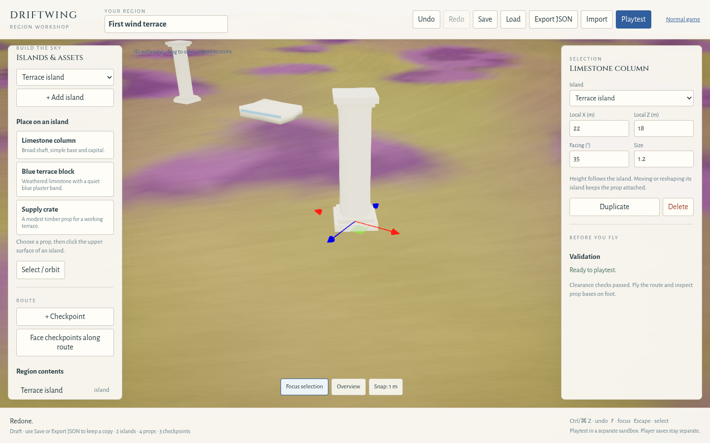
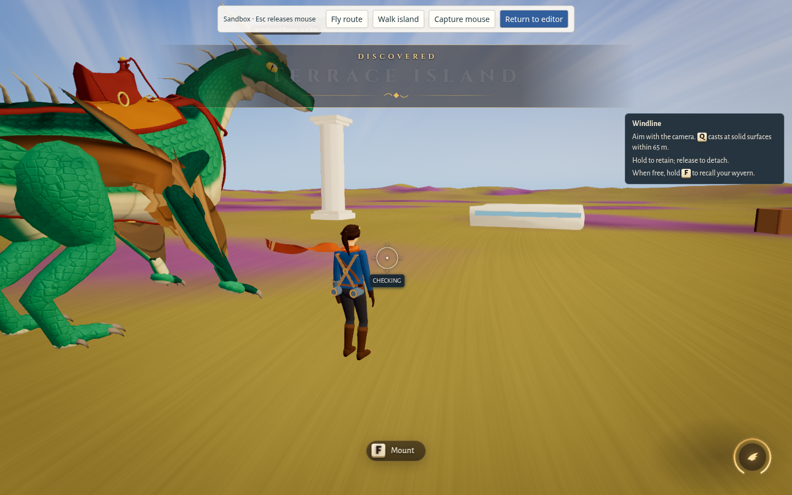
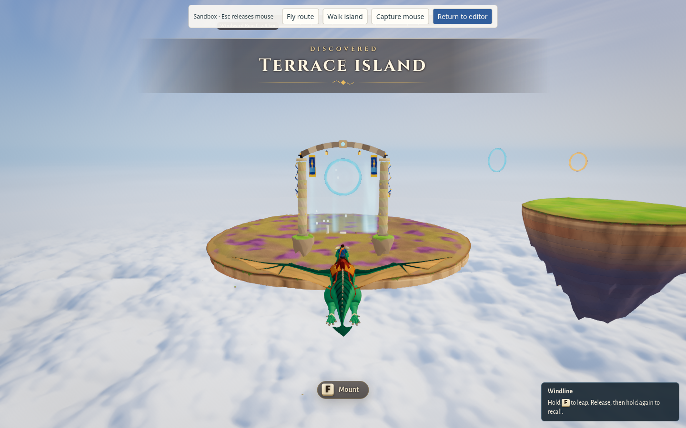
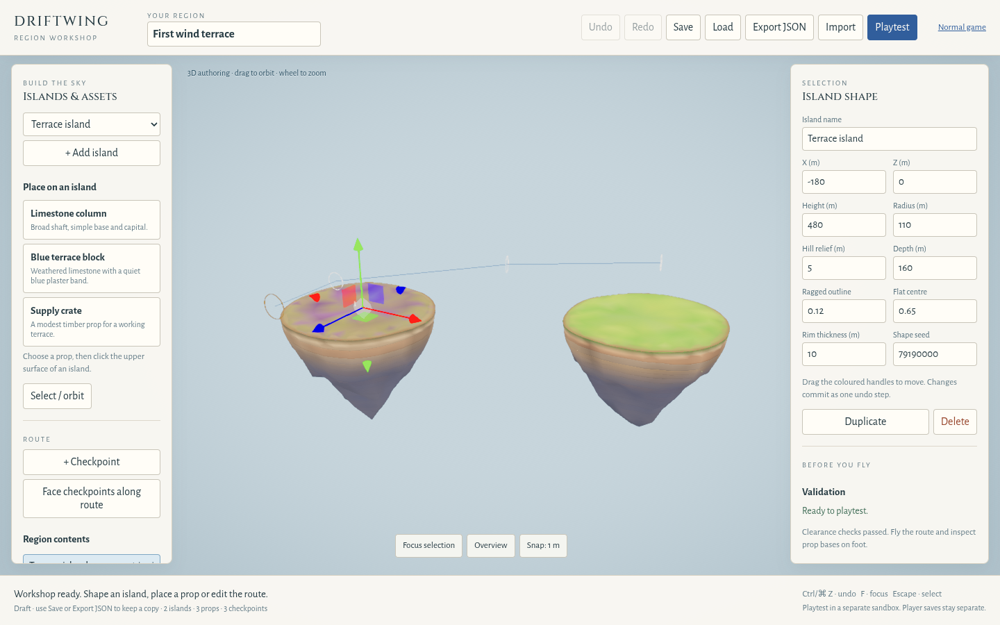

# Region workshop rendered review

The shared authority is [ART_DIRECTION.md](ART_DIRECTION.md), the [master v2](art/Driftwing_Codex_Handoff/01_Sky_Lance/Art_Direction_Master.md) and [pack introduction](art/Driftwing_Codex_Handoff/README_START_HERE.md). They specify limestone terraces and broad columns, blue plaster, restrained detail and Aegean architecture. These are proposed directions; this draft does not assert production art approval.

## Reference and implementation comparison

The existing supplied palette reference is shown for comparison; it was not copied into runtime assets.

The three-item palette in `src/editor/assets.ts` reuses the procedural column, stone-block and crate kits. Column and terrace use the master limestone `#D8D1C2`; the terrace's small band uses sky blue `#7FA8C4`. The crate retains the existing timber treatment. The column is 7 m tall with a broad 0.85 m shaft radius and simple base/capital. The terrace is 6 × 1.2 × 4 m before its small plaster band. Uniform size ranges from 0.5 to 2.

Editor lighting is an inspection aid. The on-foot and mounted captures below use the sandbox's existing gameplay renderer, sky and cameras.

| Category | Source / implementation / evidence | Observed match and gap | Status |
| --- | --- | --- | --- |
| Architecture | Master architecture guidance; `src/editor/assets.ts`; on-foot and editor-column captures | Broad simple column, limestone terrace and quiet blue band. Silhouette is readable; weathering is faint and bases need owner review. No arcade, canvas or architectural set is supplied. | Partial, owner review pending |
| Palette / materials | Master swatches and supplied faction palette; `src/editor/assets.ts`; on-foot capture | Curated limestone and blue band follow the swatches; crate remains existing timber. Current island ground is the existing golden/purple plateau treatment. Full environment palette is outside this change. | Partial |
| Costume / silhouette | Master costume corrections; existing rider; on-foot / mounted captures | Existing rider is unchanged and still visibly differs from the proposed pale-cloth direction. No wardrobe compliance claim. | Not verified |
| Armor / detail | Master armor guidance; existing rider; on-foot / mounted captures | No armor work; representative views do not establish compliance. | Not verified |
| Lance / banner | Master and current Windline override; existing race gate / rider; mounted capture | Existing gate flags and traversal equipment are unchanged. The new props do not add a lance or banner asset. | Not verified |
| Bracer / tether / harness | Shared current Windline override; existing controller / rider; mounted capture | This authoring slice adds no equipment or tether changes. No detailed close-up or motion comparison supplied. | Not verified |
| Dragons | Master dragon guidance; existing wyvern; on-foot / mounted captures | Existing dragon and flight are unchanged; no dragon art approval is inferred. | Not verified |
| Animation / camera clearance | Shared evidence requirements; `src/editor/playtest.ts`; on-foot / mounted captures | Props share collision with their generated geometry; starter-course simulation reports no collisions. Captures cover standing and mounted views, but do not certify bank/dive/brake/takeoff/dismount poses, all breeds or arbitrary placements. | Partial |

These captures come from the production build during authoring verification in Chromium 154 with SwiftShader at 1440 × 900. They are review illustrations from the pre-commit source. The final draft PR's exact-head browser report and CI artifacts are the reproducible verification record.

Owner review remains open: keep or adjust the column proportions, terrace scale and blue accent; inspect prop bases and route readability on foot and mounted; exercise repeated editing/playtest/return. No additional palette assets or puzzle systems are authorized by this document.
