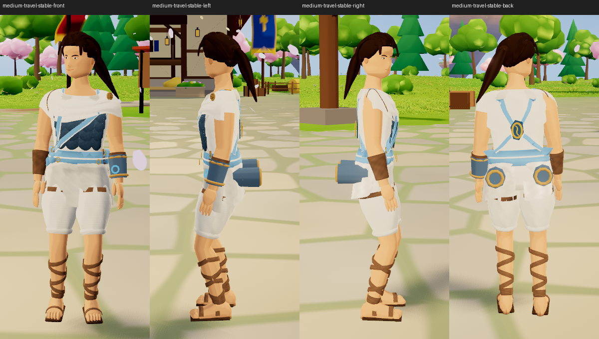
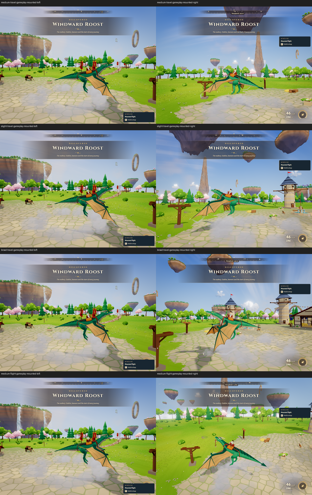
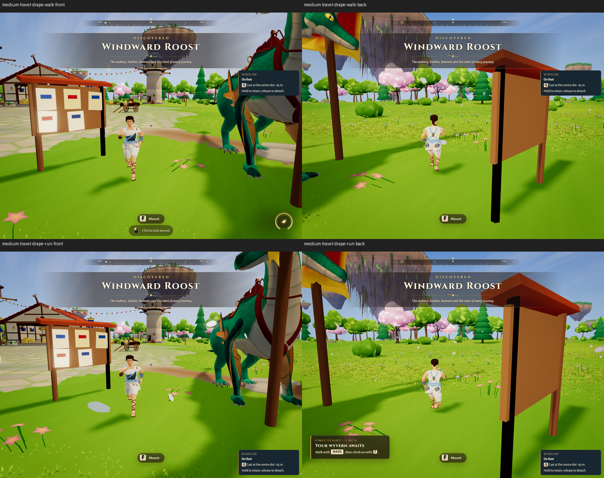

# Authored rider and Windkeel trial

This is a separate review candidate combining released Lantern Dash main
`81761be3a4ce53ee1c90cdd9957a3171fe704a8a`, the required shared rider/wardrobe
baseline `8e055069703c83308d5508ee72e5ad1d15ef348e` (PR #11), and the playtested
Blender rider overlay. It remains an explicit development selection. The normal
menu and saved appearances continue to use the generated provider by default.

The authored Medium body and existing ponytail, separate Travel Drape pieces,
thin connected shoulder wrap and fitted blue/linen/bronze Windkeel share the
existing rig, dyes, wardrobe and live cloth. Complete Travel Drape remains
Medium/Aerie; individual pieces fit Slight/Medium/Broad. No new save fields,
automatic costume conversion, traversal tuning or external asset service.

Robert reported that the local trial plays well with no observed issues. That
owner feedback supplements the recorded automated checks; the device, duration
and performance measurements of his playtest were not specified.

**Review stage:** prepare PR and stop before merge. Nothing in this candidate
authorizes a merge or deployment. The session guide remains separate in PR #13.
PR #10 and the island/artifact branches were not merged to obtain their inputs.
See [the current review record](MERGE_REVIEW.md),
[preservation matrix](PRESERVATION_MATRIX.md), and [historical four-pass QA](QA.md).

## Windows launch

Existing Node/npm dependencies are already copied into this isolated workspace.
Run in PowerShell; leave the window open:

```powershell
Set-Location 'C:\Users\Robert\.codex\worktrees\rider-merge-review\Driftwing'
npm run dev -- --host 127.0.0.1 --port 5216 --strictPort
```

Use Edge InPrivate to keep review saves separate. Open the
[normal-menu authored trial](http://127.0.0.1:5216/?riderTrial=blender&quality=low),
enter play, then open Stable → Outfit → Travel Drape. Turn the rider in Stable,
inspect both shoulders and the rear waist, try mixed pieces and dyes, then
Save/Revert, take off, bank, land and dismount. Both mounted sides matter.

Open the [same candidate's generated comparison](http://127.0.0.1:5216/?quality=low)
in a separate fresh context with the same look/quality. The independently
preserved [pre-authored presentation](http://127.0.0.1:5211/?quality=low) and
[playtested authored trial](http://127.0.0.1:5210/?riderTrial=blender&quality=low)
are still available while their existing services run. Do not stop those services
or change the owner's ordinary browser profile. These loopback links work only
on this PC; they are not Pages or a phone-accessible release.

For another checkout, install the lockfile dependencies with `npm ci`, then use
the same dev command on a free port. No Blender installation is needed to play.
For editing/export, use an existing Blender 4.5.14 LTS executable and the saved
source instructions below; no software is automatically installed.

## Gameplay and Stable evidence

Current candidate: [Stable](evidence/candidate-validation/fit/medium-travel-stable-front.png),
[mounted left](evidence/candidate-validation/fit/medium-travel-gameplay-mounted-left.png),
[mounted right](evidence/candidate-validation/fit/medium-travel-gameplay-mounted-right.png).
[Fresh validation and CPU failure](MERGE_REVIEW.md#validation).

The [October 12 fit record](FIT_REFRESH_2026-10-12.md) retains all 40 fresh frames,
including eight obstructed on-foot frames explicitly excluded from visible-fit
acceptance. The selected sheets below are real engine Stable/follow/flight views,
not Blender renders. The new PR candidate has its own validation record in
[MERGE_REVIEW.md](MERGE_REVIEW.md); these images identify the prior unchanged art.







Slight/Broad mixed fits and Medium Flight are retained beside these sheets.
Earlier matched old/new and day/night/tier captures remain in the original trial
and its verified recovery archive; that full evidence pack is not duplicated here.

## Editable source and export

The editable source is `assets/rider-blender/source/rider-trial.blend`; fitting,
bind mesh, construction views and semantic texture recipe are separate files in
that directory. Runtime exports are under `src/assets/rider-blender/`.
The .blend descriptor hash-checks its two fitting inputs. Use the saved native source
to retain manual edits; the author script recreates its own initial project.

```powershell
# Replace this path with an existing Blender 4.5.14 LTS executable.
$riderBlender = 'C:\path\to\blender.exe'
& $riderBlender assets/rider-blender/source/rider-trial.blend --background --threads 2 --python-exit-code 1 --python scripts/rider-blender-export.py
```

Export rebuilds bindings against final topology. Do not optimize topology after
binding without regenerating it. The independent byte-identical re-export proof
and log are included in `evidence/reexport/`; Blender/tool downloads and `.blend1`
backup copies remain preserved locally, outside this PR.

| File | SHA-256 |
| --- | --- |
| `rider-trial.blend` | `0b69bcbb74153a0f0bc993ee756f59048db22e5fc0d5e7a7990c39465b9fa9c4` |
| `rider-trial.glb` (19,110,536 bytes) | `d6f2ffa790d43e8217ab6d64bdfdf994b424d1d5cb1d1b8685403b2001d40dc8` |

[PR_PACKAGE_MANIFEST.json](PR_PACKAGE_MANIFEST.json) identifies published files.
Older source/reference/evidence manifests are historical inventories of the full
preserved local trial, not a promise that every archived artifact ships in this PR.

## Limits and checks

The existing software CPU gate is unresolved. Historical isolated baseline passed
while trial failed; another full-workflow baseline run also failed. Matching query
counts do not establish the cause. Dedicated RX 9070 XT measurements do not cancel
that failure or certify integrated-GPU Low, GPU time or total VRAM. See
[QA.md](QA.md) and `evidence/preserved-trial/` for exact retained results.

Cloth contacts are tested capsule/ground/deck and bounded final-surface corrections,
not arbitrary-world collision, self-collision or every possible layer intersection.
Normal/ORM harness preview maps remain preserved source, not active runtime maps.
Final concept likeness and hidden/fine fit remain owner review decisions.

Local verification uses typecheck, the full unit suite, separate existing/authored
garment audits, production build/smoke and actual-engine rider checks. The new
authored CI workflow adds fit, loading/lifecycle, Stable, rear-link motion and
offline/subpath delivery without changing existing verification or deployment gates.
